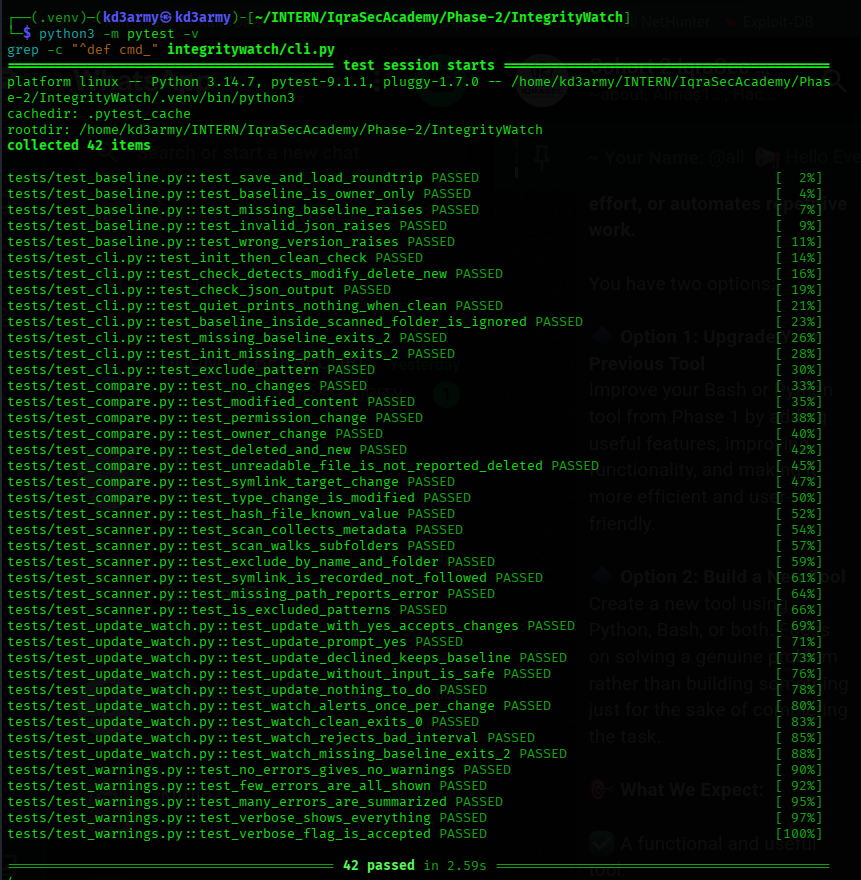
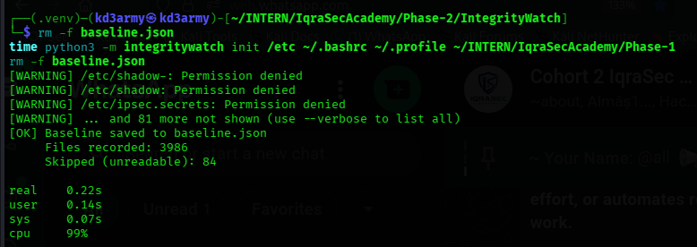
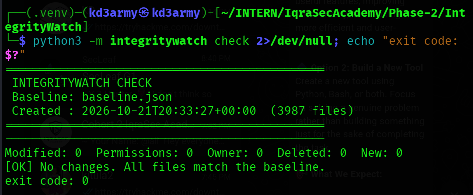
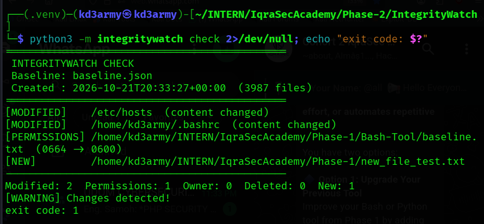
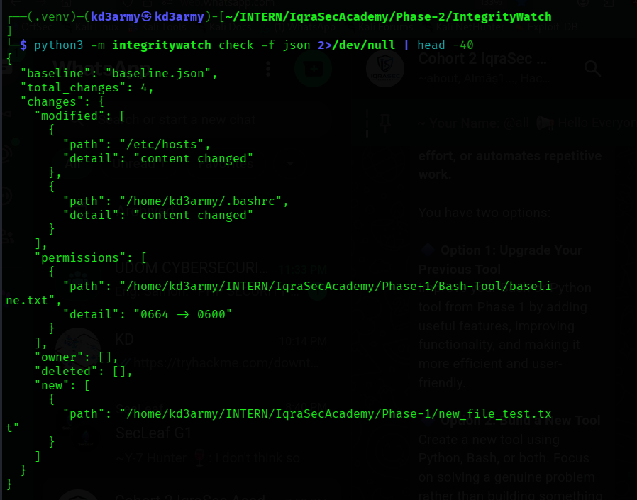
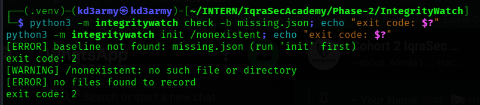
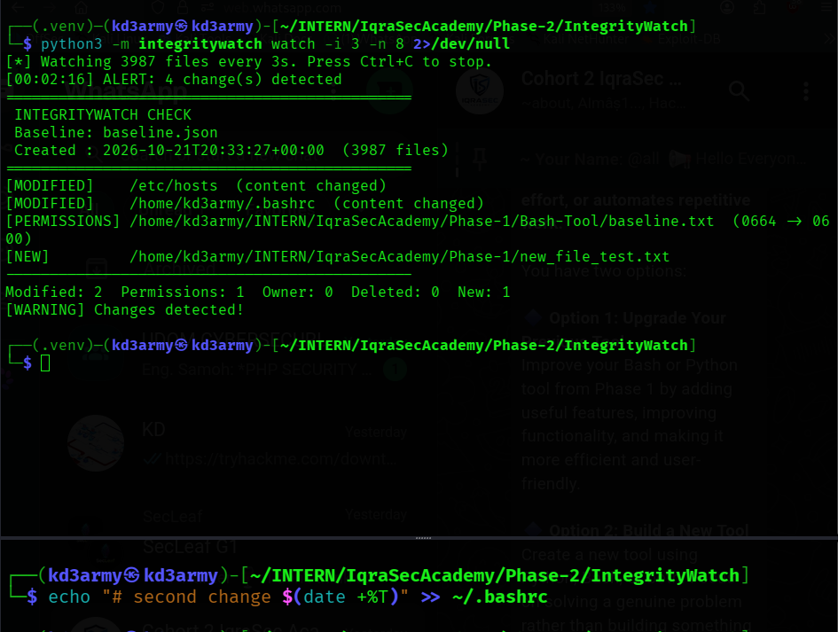
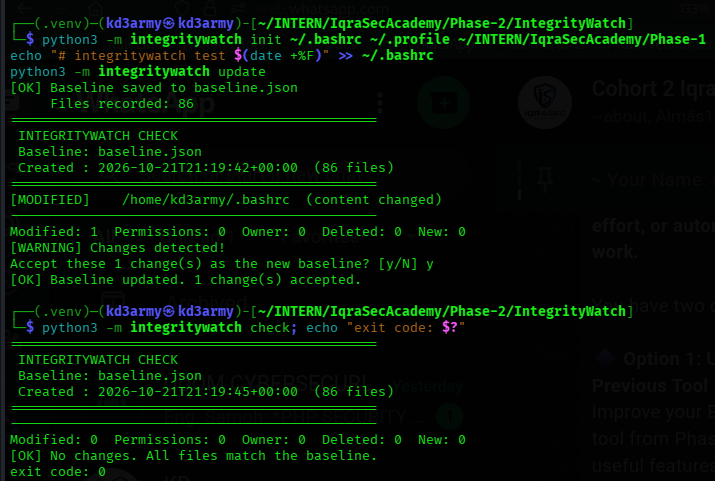
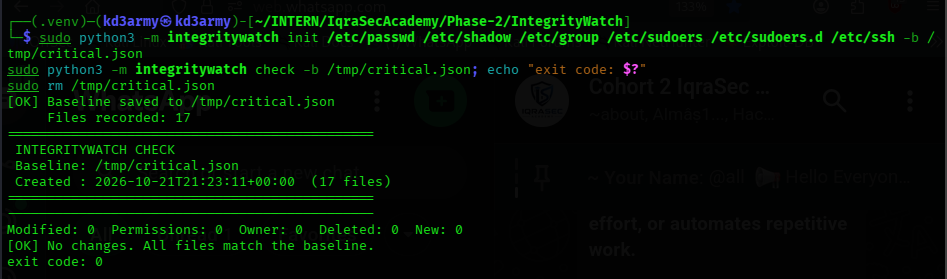

# IntegrityWatch

[](LICENSE)

A small command-line **file integrity monitor** written in Python. It records a trusted snapshot (a *baseline*) of your files, then tells you exactly what changed afterwards: modified content, changed permissions or ownership, deleted files and new files.

Built as a Phase 2 project for the IqraSec Academy Scripting & Automation internship. It is an upgrade of the Bash file integrity checker from my Phase 1 project, rebuilt in Python with more checks, JSON output and automated tests.

## Why this exists
When an attacker (or a mistake) changes a file such as `/etc/hosts`, `/etc/sudoers`, an SSH config or a shell startup file, a normal system gives no warning. File integrity monitoring (FIM) is a standard defence against this, used by tools such as AIDE and Tripwire. IntegrityWatch is a small, readable, standard-library-only tool that does the core job and is easy to script, because its exit codes tell a script whether anything changed.

## Features
- SHA-256 content hashing (files are read in 1 MB chunks, so large files are fine)
- Tracks permissions, owner and group, size, modification time and symlink targets
- Reports `[MODIFIED]`, `[PERMISSIONS]`, `[OWNER]`, `[DELETED]` and `[NEW]` separately
- Exclude patterns (for example `-e '*.log'`) to skip noisy files
- Text or JSON output
- `update` to accept legitimate changes, with a confirmation prompt
- `watch` to check repeatedly and alert only when the set of changes is new
- Script-friendly exit codes and a `--quiet` mode
- Baseline is saved atomically with `0600` permissions
- Unreadable files produce a warning instead of a false "deleted" report
- No third-party dependencies

## Installation
```bash
git clone https://github.com/kd3army/IntegrityWatch.git
cd IntegrityWatch
python3 -m venv .venv && source .venv/bin/activate
pip install .
integritywatch --help
```
You can also run it without installing: `python3 -m integritywatch --help`.

Requires Python 3.9+ (developed and tested on Python 3.14.7, Kali Linux).

## Usage

| Command | Purpose |
|---|---|
| `init PATH... [-b FILE] [-e PATTERN] [-v]` | Scan files/folders and save a baseline |
| `check [-b FILE] [-f text\|json] [-q] [-v]` | Compare the current state with the baseline |
| `update [-b FILE] [-y] [-v]` | Accept the current state as the new baseline |
| `watch [-b FILE] [-i SECONDS] [-n COUNT] [-v]` | Check repeatedly and alert on changes |

```bash
integritywatch init /etc/ssh ~/.bashrc -e '*.log'   # create the baseline
integritywatch check                                # compare
integritywatch check -f json                        # machine-readable output
integritywatch check -q                             # silent when clean
integritywatch update                               # accept changes (asks first)
integritywatch watch -i 30                          # check every 30 seconds
```

The default baseline file is `baseline.json` in the current folder. Use `-b` to choose another. Scan warnings are summarized by default; add `-v` to list every unreadable file.

### Exit codes
| Code | Meaning |
|---|---|
| 0 | No changes |
| 1 | Changes detected |
| 2 | Error (for example, missing baseline or bad arguments) |

## Tested on a real system
These results come from running the tool on my own Kali Linux machine (Python 3.14.7), not from sample data.

| What | Result |
|---|---|
| Monitored | `/etc`, `~/.bashrc`, `~/.profile` and my Phase 1 project folder |
| Files recorded | 3,987 |
| Not readable as a normal user | 84 (for example `/etc/shadow`, `/etc/sudoers`, SSH host keys) |
| Scan time | 0.78 s on the first run, 0.17 s on the second |
| Check with nothing changed | 0 changes, exit code 0 |

### Detecting real changes
I then made four real changes: appended a line to `~/.bashrc`, appended a test entry to `/etc/hosts` (with `sudo`), changed a file's permissions with `chmod 600`, and created a new file. IntegrityWatch reported all four:

```
==============================================
 INTEGRITYWATCH CHECK
 Baseline: baseline.json
 Created : 2026-10-21T20:33:27+00:00  (3987 files)
==============================================
[MODIFIED]    /etc/hosts  (content changed)
[MODIFIED]    /home/kd3army/.bashrc  (content changed)
[PERMISSIONS] /home/kd3army/INTERN/IqraSecAcademy/Phase-1/Bash-Tool/baseline.txt  (0664 -> 0600)
[NEW]         /home/kd3army/INTERN/IqraSecAcademy/Phase-1/new_file_test.txt
----------------------------------------------
Modified: 2  Permissions: 1  Owner: 0  Deleted: 0  New: 1
[WARNING] Changes detected!
exit code: 1
```
I reverted all four changes afterwards.

### Watch mode
```
[*] Watching 3987 files every 3s. Press Ctrl+C to stop.
[00:02:16] ALERT: 4 change(s) detected
```
The alert is followed by the same report as above. It prints once per new set of changes, not on every cycle.

### Accepting a change with `update`
```
$ integritywatch init ~/.bashrc ~/.profile ~/INTERN/IqraSecAcademy/Phase-1
[OK] Baseline saved to baseline.json
     Files recorded: 86
$ echo "# integritywatch test $(date +%F)" >> ~/.bashrc
$ integritywatch update
==============================================
 INTEGRITYWATCH CHECK
 Baseline: baseline.json
 Created : 2026-10-21T21:19:42+00:00  (86 files)
==============================================
[MODIFIED]    /home/kd3army/.bashrc  (content changed)
----------------------------------------------
Modified: 1  Permissions: 0  Owner: 0  Deleted: 0  New: 0
[WARNING] Changes detected!
Accept these 1 change(s) as the new baseline? [y/N] y
[OK] Baseline updated. 1 change(s) accepted.
$ integritywatch check; echo "exit code: $?"
==============================================
 INTEGRITYWATCH CHECK
 Baseline: baseline.json
 Created : 2026-10-21T21:19:45+00:00  (86 files)
==============================================
----------------------------------------------
Modified: 0  Permissions: 0  Owner: 0  Deleted: 0  New: 0
[OK] No changes. All files match the baseline.
exit code: 0
```

### Root-only files
Run as a normal user, the tool cannot read the most sensitive files. Running it with `sudo` on the critical ones covers all of them:

```
$ sudo python3 -m integritywatch init /etc/passwd /etc/shadow /etc/group /etc/sudoers /etc/sudoers.d /etc/ssh -b /tmp/critical.json
[OK] Baseline saved to /tmp/critical.json
     Files recorded: 17
$ sudo python3 -m integritywatch check -b /tmp/critical.json; echo "exit code: $?"
==============================================
 INTEGRITYWATCH CHECK
 Baseline: /tmp/critical.json
 Created : 2026-10-21T21:23:11+00:00  (17 files)
==============================================
----------------------------------------------
Modified: 0  Permissions: 0  Owner: 0  Deleted: 0  New: 0
[OK] No changes. All files match the baseline.
exit code: 0
```

### Error handling
```
[ERROR] baseline not found: missing.json (run 'init' first)
exit code: 2
[WARNING] /nonexistent: no such file or directory
[ERROR] no files found to record
exit code: 2
```

## Screenshots

### Automated tests (42 passing)


### Creating a baseline of the real system


### Clean check


### Real changes detected


### JSON output


### Error handling (screenshot)


### Watch mode


### Accepting changes with update


### Monitoring root-only files with sudo


## How it works
```
integritywatch/
├── scanner.py   walks files, hashes them, collects metadata
├── baseline.py  saves and loads the JSON baseline (0600, atomic write)
├── compare.py   compares two snapshots and returns what changed
└── cli.py       the init, check, update and watch commands
```
- The scanner uses `lstat`, so a symlink is recorded as a symlink and never followed.
- `compare()` takes two dictionaries and returns a result, so it is easy to test without touching the disk.
- A file that cannot be read during a check is reported as a warning, not as deleted.
- The baseline file excludes itself from scans.
- `update` always shows the changes first and asks for confirmation. With no input at all (for example from cron), it changes nothing.

## Tests
```bash
pip install pytest
python3 -m pytest -v
```
42 tests pass (2.59 s on my machine). They cover the scanner, baseline storage, comparison logic, warning handling, and end-to-end runs of the real command line. Unit tests use temporary files so they are repeatable. All the real-system results above come from the live machine.

## Challenges faced
- **A wall of warnings.** Scanning `/etc` as a normal user produced 84 permission warnings, which flooded the terminal and exposed private file names such as saved Wi-Fi profiles. Warnings are now summarized (the first 3, plus a count), and `-v` shows everything.
- **An invisible prompt.** The `update` confirmation prompt disappeared when stderr was redirected, so the command looked frozen. The prompt is now printed to standard output.
- **Root-only files.** The files that matter most (`/etc/shadow`, `/etc/sudoers`, SSH host keys) need root to read, so the tool has to be run with `sudo` for full coverage.

## Limitations
- `watch` polls on an interval, so a change made and reverted between two checks is missed. It is not real-time.
- If an attacker can write to the baseline file, they can hide changes. Keep the baseline somewhere protected, such as read-only media or another machine.
- It reports that a file changed, not what changed inside it (no diff).
- Developed and tested on Linux only.

## Future improvements
- Real-time monitoring with Linux inotify
- Sign the baseline (for example with an HMAC) so tampering is detectable
- Show text diffs for changed files
- Email or syslog alerts
- A config file with named monitoring profiles
- Use one time zone in all output (the baseline uses UTC, `watch` uses local time)

## Contributing
Issues and pull requests are welcome. Fork the repo, create a branch, run `python3 -m pytest` before opening a pull request, and keep new code covered by tests.

## Disclaimer
Only use this tool on systems you own or have permission to monitor.

## License
[MIT](LICENSE)

## Author
[kd3army](https://github.com/kd3army)
